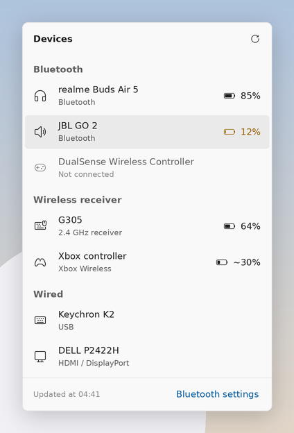
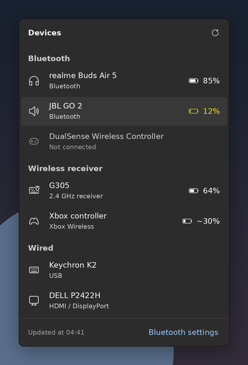

# BatteryTray

[Русский](README.md) | English

A Windows 10 and 11 app that shows the battery level of your wireless devices in the system tray, next to the clock.

<p>
  
  
</p>

## What it does

Windows keeps the battery level of your headphones or mouse buried in Settings, and for many devices
on a wireless receiver it doesn't show it at all. BatteryTray puts everything in one place: click the tray icon
and you get a list of connected devices with their battery levels. When something is running low, you get a notification.

It isn't tied to any brand. It shows whatever is connected to your PC: headphones, speakers, mice, keyboards or gamepads.

## Features

- The tray icon shows the device with the lowest battery.
- The list is split into three groups: Bluetooth, wireless receiver and wired.
- Notifications at 20% and 10%, and when a device connects or disconnects.
- Optional battery label right on the taskbar.
- Light, dark and translucent themes, or follow the system.
- Russian and English interface, picked from your Windows language or set in the menu.
- Starts with Windows if you want it to.
- A single exe. No installation, no network access.

## How the battery level is read

For Bluetooth devices it's the same number Windows shows in Settings. If Windows doesn't know it,
the app asks the device directly using the standard Bluetooth battery service.

Wireless receivers are trickier because every vendor uses its own protocol.
Right now Logitech receivers (Unifying, Lightspeed, Bolt) and Xbox controllers are supported.
Devices on other receivers still show up in the list, just without a percentage.
If a device only reports a rough level, the percentage is marked with `~`.

Wired devices are simply listed, they don't have a battery.

## Installation

Download `BatteryTray.exe` from [Releases](../../releases) and run it.

Requirements: Windows 10 version 1809 or later, or Windows 11, with .NET Framework 4.6.2,
which is already part of Windows.

The exe isn't digitally signed, so Windows SmartScreen may show a warning the first time you run it.
Click "More info", then "Run anyway".

If you don't see the icon, Windows may have put it in the hidden area under the `^` arrow.
Drag it onto the taskbar or turn it on in Settings → Personalization → Taskbar.

## Usage

Left click the icon to open the device list. Clicking a device opens its page in Windows Settings.
`F5` refreshes the list, `Esc` closes it.

Right click opens the menu: theme, language, taskbar label, notifications, autostart.

The list refreshes every 15 seconds and after the PC wakes from sleep.

## Building from source

You don't need Visual Studio, the `csc.exe` compiler that comes with .NET Framework is enough:

```cmd
build.cmd
```

The result goes to the `bin` folder. GitHub Actions builds every commit, and a tag like `v1.0.0` publishes a release.

Command line switches for debugging:

| Switch | What it does |
|---|---|
| `--selftest` | scans devices and writes the result to the log |
| `--preview [folder]` | saves screenshots of the window in every theme |
| `--make-icon [file]` | regenerates `app.ico` |

The code lives in `src`. Device scanning is in `DevicePoller.cs`, the list window in `PopupForm.cs`,
WinAPI calls in the `Native` folder.

## Settings and uninstalling

Settings are stored in the registry under `HKCU\Software\BatteryTray`, the log in `%LOCALAPPDATA%\BatteryTray`.

To uninstall, turn off autostart in the menu, exit the app and delete the exe.
For a full cleanup, also delete the registry key and the log folder.

## Feedback

If a device doesn't show up or its battery level looks wrong, open an [issue](../../issues) and attach the log.
You can find it from the menu: right click the icon, "Open log folder".

## License

[MIT](LICENSE)
