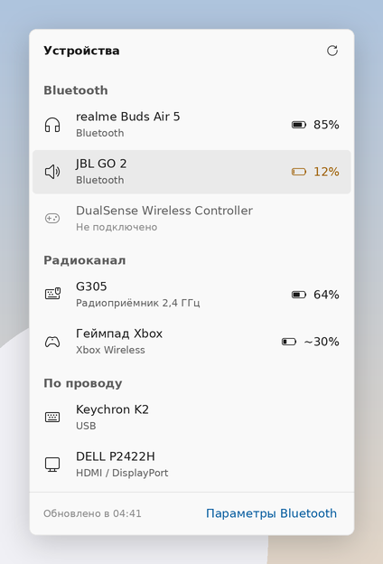
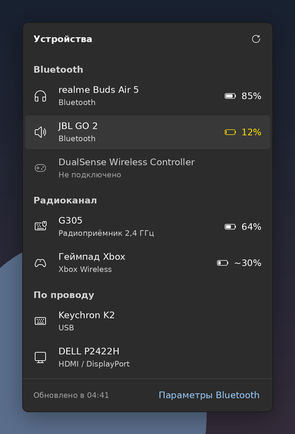
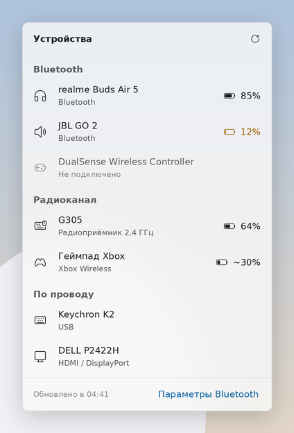
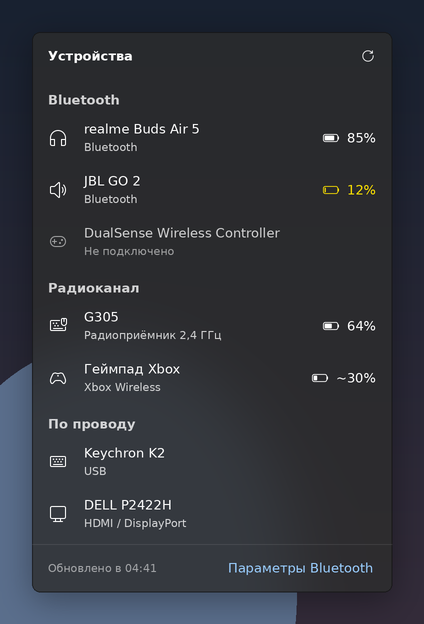

# BatteryTray

Русский | [English](README.en.md)

Программа для Windows 10 и 11, которая показывает заряд беспроводных устройств в трее рядом с часами.

<p>
  
  
</p>

## Что это

В Windows заряд наушников или мыши спрятан в «Параметрах», а для многих устройств на радиоприёмнике его нет вовсе.
BatteryTray собирает всё в одном месте: нажимаете на значок в трее и видите список подключённых устройств с процентом заряда.
Если что-то начинает садиться, приходит уведомление.

Программа не привязана к производителю. Она показывает те устройства, которые подключены к вашему компьютеру,
будь то наушники, колонка, мышь, клавиатура или геймпад.

## Возможности

- Значок батареи в трее показывает устройство с самым низким зарядом.
- Список делится на три группы: Bluetooth, радиоприёмник и провод.
- Уведомления при 20% и 10% заряда, а также при подключении и отключении.
- Подпись с процентами прямо на панели задач (можно выключить).
- Светлая, тёмная и полупрозрачная тема, либо как в системе.
- Интерфейс на русском и английском, язык выбирается по Windows или в меню.
- Автозапуск вместе с Windows.
- Один exe-файл. Установка не нужна, в интернет программа не обращается.

<p>
  
  
</p>

## Как программа узнаёт заряд

У Bluetooth-устройств берётся тот же процент, что Windows показывает в «Параметрах».
Если Windows его не знает, программа запрашивает заряд у самого устройства по стандартному протоколу Bluetooth.

С радиоприёмниками сложнее: каждый производитель использует свой протокол.
Сейчас поддерживаются приёмники Logitech (Unifying, Lightspeed, Bolt) и геймпады Xbox.
Устройства на других приёмниках тоже появятся в списке, но без процента.
Если какое-то устройство сообщает только примерный уровень, перед процентом стоит знак `~`.

Проводные устройства просто показываются в списке, заряда у них нет.

## Установка

Скачайте `BatteryTray.exe` на странице [Releases](../../releases) и запустите.

Требования: Windows 10 версии 1809 или новее либо Windows 11. Нужен .NET Framework 4.6.2,
он уже входит в состав Windows.

Файл не подписан цифровой подписью, поэтому при первом запуске Windows SmartScreen может показать предупреждение.
Нажмите «Подробнее», затем «Выполнить в любом случае».

Если значок не виден в трее, он мог попасть в скрытую область под стрелкой `^`.
Перетащите его на панель задач или включите в «Параметры → Персонализация → Панель задач».

## Использование

Левый клик по значку открывает список устройств. Клик по устройству открывает его параметры в Windows.
`F5` обновляет список, `Esc` закрывает.

Правый клик открывает меню с настройками: тема, язык, подпись на панели задач, уведомления, автозапуск.

Список обновляется сам каждые 15 секунд и после выхода компьютера из спящего режима.

## Сборка из исходников

Visual Studio не понадобится. Достаточно компилятора `csc.exe`, который входит в .NET Framework:

```cmd
build.cmd
```

Готовый файл появится в папке `bin`. Сборка также запускается в GitHub Actions при каждом коммите,
а тег вида `v1.0.0` создаёт релиз.

Ключи командной строки для отладки:

| Ключ | Действие |
|---|---|
| `--selftest` | опрашивает устройства и пишет результат в журнал |
| `--preview [папка]` | сохраняет скриншоты окна во всех темах |
| `--make-icon [файл]` | заново создаёт `app.ico` |

Код находится в папке `src`. Опрос устройств в `DevicePoller.cs`, окно со списком в `PopupForm.cs`,
работа с WinAPI в папке `Native`.

## Настройки и удаление

Настройки хранятся в реестре в разделе `HKCU\Software\BatteryTray`, журнал в папке `%LOCALAPPDATA%\BatteryTray`.

Чтобы удалить программу, выключите автозапуск в меню, закройте её и удалите exe-файл.
Для полной очистки удалите также раздел реестра и папку с журналом.

## Обратная связь

Если устройство не появилось в списке или заряд показан неверно, создайте [issue](../../issues)
и приложите журнал. Открыть его можно из меню: правый клик по значку, «Открыть папку с журналом».

## Лицензия

[MIT](LICENSE)
